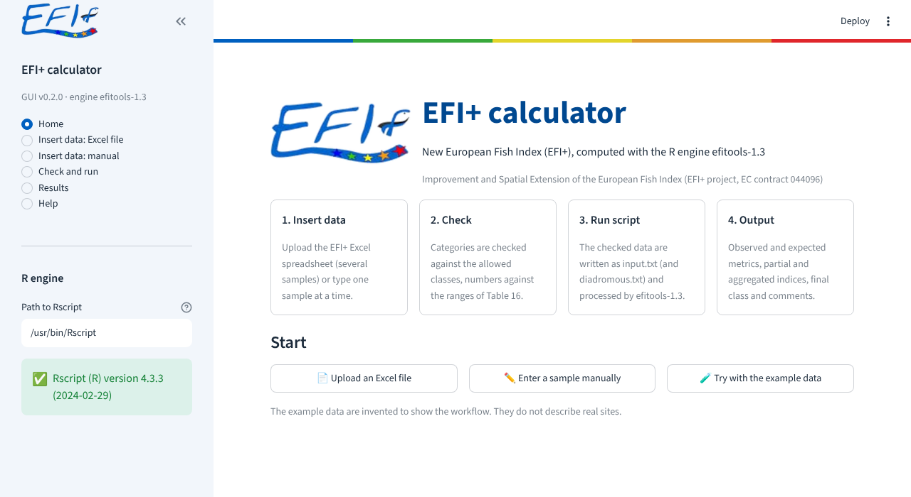
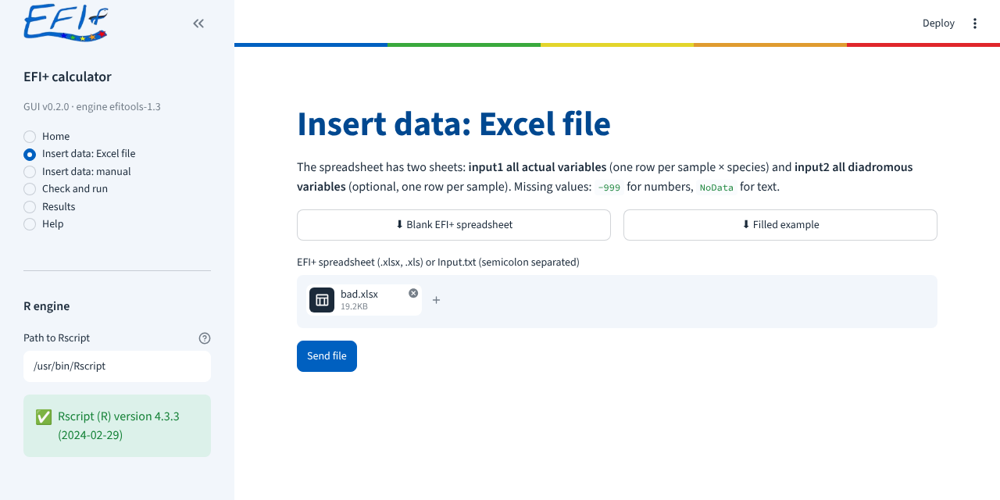
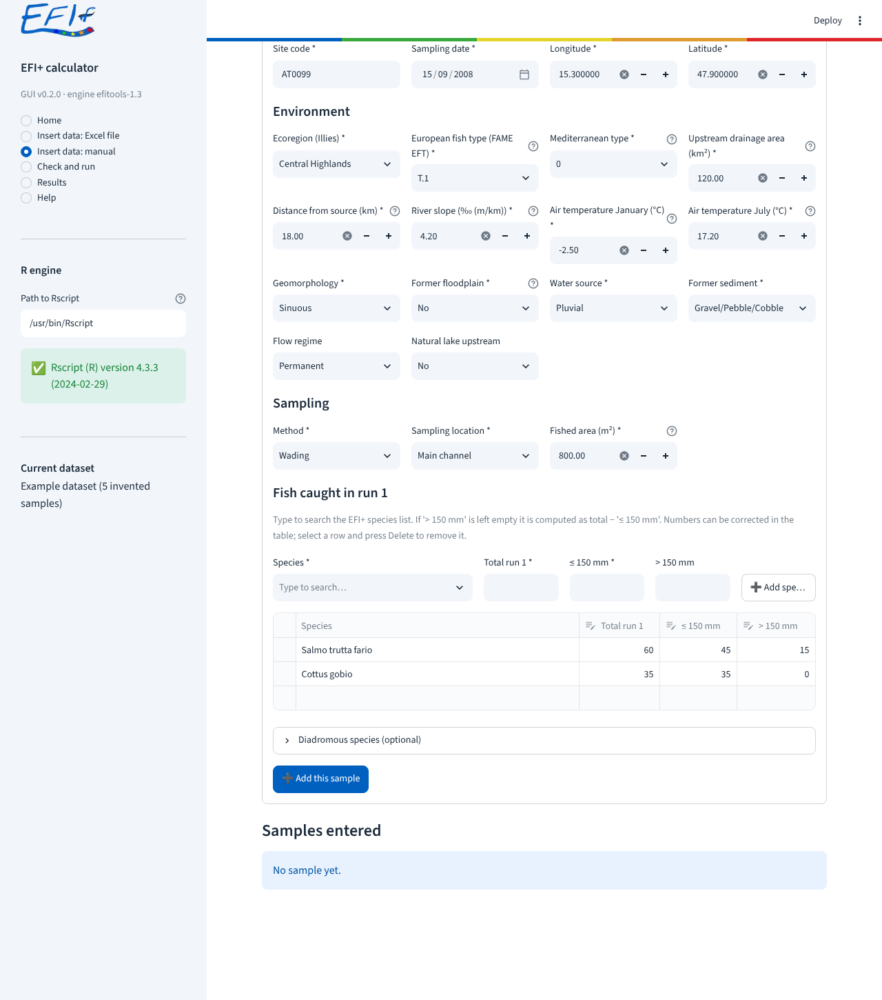
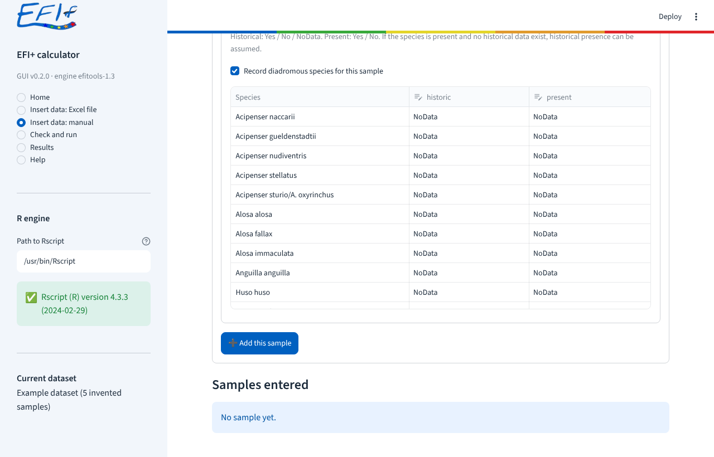
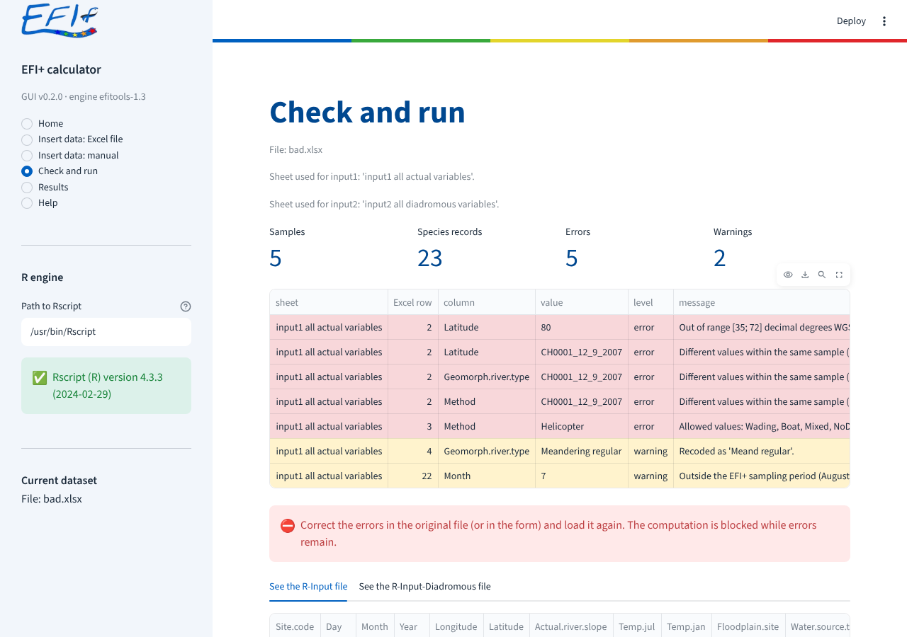
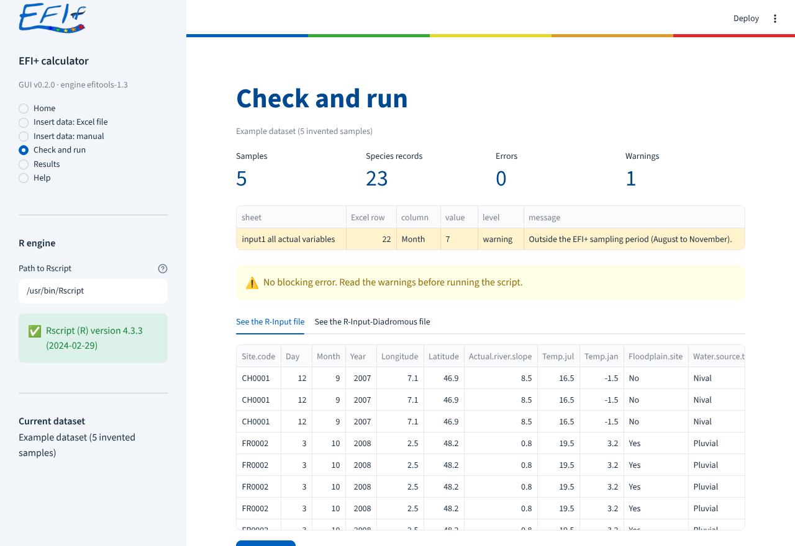
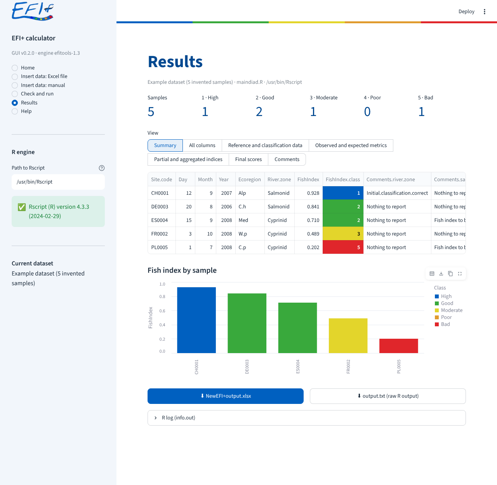
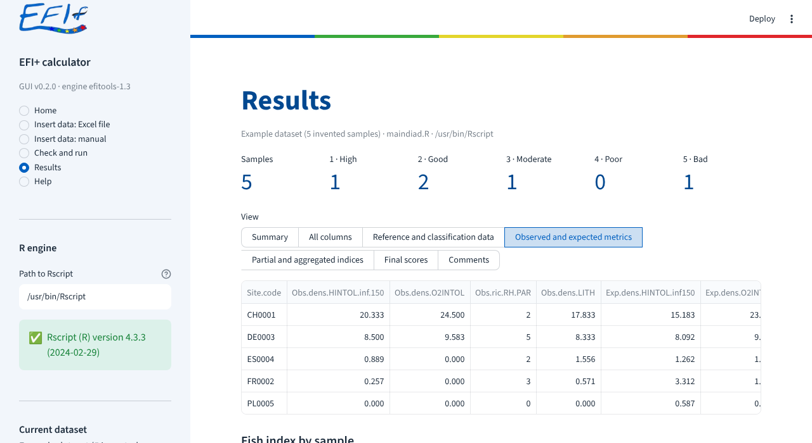
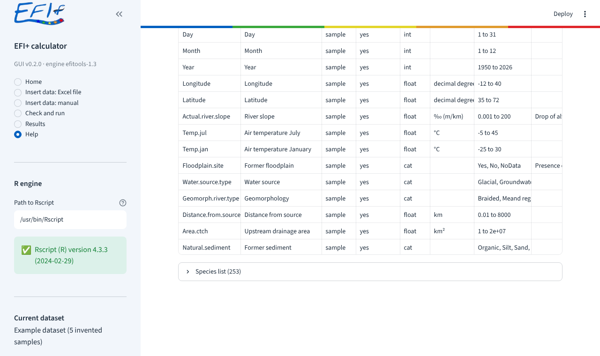

# EFI+ calculator – User guide (Streamlit version)

> Développé avec l’aide de l’IA (Claude, Anthropic), sous la relecture active de Pierre Bady.

This guide explains how to compute the new European Fish Index (EFI+) with the Streamlit
version of the EFI+ calculator. The calculator follows Part II of the *Manual for the
application of the new European Fish Index – EFI+* (EFI+ consortium, June 2009) and uses the
R engine **efitools-1.3** for the computation.

A NiceGUI version with the same functions exists: see `USER_GUIDE_nicegui.md`.

Contents

1. [Installation and start](#1-installation-and-start)
2. [The screen](#2-the-screen)
3. [Quick start with the example data](#3-quick-start-with-the-example-data)
4. [Insert data from an Excel file](#4-insert-data-from-an-excel-file)
5. [Insert data manually](#5-insert-data-manually)
6. [Check and run](#6-check-and-run)
7. [Results](#7-results)
8. [Help page](#8-help-page)
9. [Reading the results](#9-reading-the-results)
10. [Known limitations](#10-known-limitations)
11. [Troubleshooting](#11-troubleshooting)

---

## 1. Installation and start

### What you need

| Software | Version tested | Notes |
|---|---|---|
| Python | 3.13 | |
| R | 4.3.3, 4.5.3, 4.6.2 (Linux) | Package MASS (installed with R). `Rscript` must be available. |
| Python packages | see `requirements.txt` | Streamlit 1.66 or later. |

Older versions were not tested.

### Install

```bash
git clone https://github.com/badozor/EFIplusExtension.git
cd EFIplusExtension
python -m pip install -r requirements.txt
```

### Start

- Windows: double-click `run_streamlit.bat`.
- Linux / macOS: `./run_streamlit.sh` or `streamlit run app_streamlit.py`.

The application opens in your web browser at **http://localhost:8501**. It runs on your own
computer: the data are not sent to any server.

Options:

| Option | Effect |
|---|---|
| `EFI_RSCRIPT` (environment variable) | Full path to `Rscript` (if R is not found automatically). |
| `EFI_ENGINE_DIR` (environment variable) | Folder of the R engine (default: `engine/` of the repository). |
| `streamlit run app_streamlit.py --server.port 8502` | Use another port. |

To stop the application, close the terminal window or press `Ctrl+C` in it.

---

## 2. The screen



- **Sidebar (left)**: EFI+ logo, application name, version of the GUI and of the engine, and
  the menu: Home, Insert data: Excel file, Insert data: manual, Check and run, Results, Help.
  The `«` button hides the sidebar; `»` shows it again.
- **R engine (sidebar)**: path to `Rscript` and R version.
  - ✅ green box: R is found, the computation can run.
  - ⛔ red box: R or an engine file is missing (see [Troubleshooting](#11-troubleshooting)).
  - To use another R installation, type the full path to `Rscript` in **Path to Rscript** and
    press Enter.
- **Current dataset (sidebar)**: name of the data loaded for the check.
- The coloured band at the top repeats the colours of the five ecological classes.
- The **Deploy** button and the **⋮** menu (top right) belong to Streamlit. They are not needed
  to use the calculator.

> The data are kept only while the browser tab is open. Reloading the page (F5) starts a new
> session and the data entered are lost. Use **Get Excel copy of input data** to keep manual
> entries.

---

## 3. Quick start with the example data

1. On **Home**, click **Try with the example data**.
2. The **Check and run** page opens: 5 samples, 23 species records, no error.
3. Click **Run script**.
4. The **Results** page opens.

The example data are invented to show the workflow. They do not describe real sites.

---

## 4. Insert data from an Excel file



### 4.1 Get the spreadsheet

- **Blank EFI+ spreadsheet** downloads `EFI+SpreadSheet.xlsx`.
- **Filled example** downloads the same file with the 5 example samples.

The spreadsheet contains two sheets:

| Sheet | Content | Mandatory |
|---|---|---|
| `input1 all actual variables` | One row per sample × species. Site, environment, sampling and catch. | yes |
| `input2 all diadromous variables` | One row per sample. Historical and present occurrence of 17 diadromous species. | no |

Help built into the spreadsheet:

- Header colours: dark blue = mandatory column, light blue = optional column.
- Each header has a comment with the definition, the unit, the allowed range and the missing
  value code.
- Categorical columns have a drop-down list. Numerical columns warn when a value is outside the
  allowed range.

### 4.2 Fill it in

- **One row per species and per sample** in `input1`. The site and sampling variables must be
  repeated, identical, on every row of the same sample.
- A sample is identified by **Site code + Day + Month + Year**.
- **Missing values**: `-999` for numbers, `NoData` for text.
- **Species**: scientific name from the EFI+ species list (253 species, see Help ›
  Input variables › Species list). Spaces or dots are accepted (`Salmo trutta fario` or
  `Salmo.trutta.fario`).
- **Length classes**: `Number.length.below.150` + `Number.length.over.150` must equal
  `Total.number.run1`.
- **Diadromous species** (`input2`): `Yes`, `No` or `NoData` for each `historic` and `present`
  column. A row of `input2` must have the same Site code and date as a sample of `input1`.
- **Ecoregion** (`Ecoreg`): can be left empty when an ecoregion layer is set. It is then
  assigned from the coordinates (see
  [Ecoregion from the coordinates](#ecoregion-from-the-coordinates)). The Illies number (`1`–`25`)
  and the names of the GIS layer (`England`, `Italy and Corsica`, …) are also accepted.

The allowed values of every variable are listed in Help › Input variables (Tables 14 and 16 of
the manual).

### Ecoregion from the coordinates

This needs a map of the Illies ecoregions (WFD, Annex XI). No map is shipped with the GUI: the
layer of the EFI+ project is not public. Give your own layer:

- **Sidebar › Ecoregion map › Path to the ecoregion layer**, or
- environment variable `EFI_ECOREG_LAYER`, or
- copy the files of the layer (`.shp`, `.shx`, `.dbf`, `.prj`) to the folder `local/ecoregions/`.

The layer must contain polygons and an attribute `AREA_ID` with the Illies number (1–25). A
GeoJSON file is also accepted. Without a layer, the ecoregion must be typed, as before.

- **Ecoregion empty**: it is assigned from Longitude and Latitude. A warning gives the ecoregion
  found.
- **Ecoregion given**: it is kept. A warning appears when the coordinates fall in another
  ecoregion, except for sites less than 5 km from the border of the given ecoregion.
- **Site less than 5 km from another ecoregion**: the warning asks to check the ecoregion. The
  map is coarse.
- **Site outside the map** (sea, coast) but less than 10 km from it: the nearest ecoregion is
  used.
- **Site in an ecoregion not covered by EFI+** (Ireland, Iceland, Balkans 5–7, Caucasus, Caspic
  depression, Taiga, Tundra): error. efitools only knows 16 of the 25 Illies ecoregions.

The 5 km and 10 km thresholds are choices of this GUI, not values of the EFI+ manual.

### 4.3 Upload

1. Drop the file on the upload area, or click **Browse files**.
2. Click **Send file**. The **Check and run** page opens.

Accepted files: `.xlsx`, `.xls` (needs the Python package `xlrd`), `.txt` and `.csv`
(`Input.txt`: semicolon-separated text file with the column names of `input1`).

Sheets are recognised by their name (`input1…`, `input2…`). Otherwise the first sheet is used as
`input1` and the second as `input2`. The page shows which sheets were used.

---

## 5. Insert data manually

Use this page for a few samples. Each sample is entered once, then added to a list.



### 5.1 Site, environment and sampling

- Fields marked `*` are mandatory.
- Categories are chosen in lists. The `?` icon next to some fields gives their definition or
  range.
- Number fields accept only values within the allowed range (Table 16). An empty field means a
  missing value.
- **Sampling date**: choose the date in the calendar (format DD/MM/YYYY).
- **Ecoregion**: when an ecoregion layer is set, filled from the map as soon as Longitude and
  Latitude are typed. The line
  below the field gives the Illies ecoregion found. It can still be changed by hand.

### 5.2 Fish caught in run 1

1. In **Species**, type a few letters and choose the species in the list.
2. Enter **Total run 1** and **≤ 150 mm**.
3. **> 150 mm** can stay empty: it is then computed as total − (≤ 150 mm).
4. Click **➕ Add species**. The species appears in the table below.

- To correct a number: double-click the cell in the table.
- To remove a species: click the empty cell on the left of its row to select the row, then press
  the Delete key (or click the bin icon that appears above the table).
- New species must be added with **➕ Add species** (the species name cannot be typed in the
  table).

### 5.3 Diadromous species (optional)



1. Open **Diadromous species (optional)**.
2. Tick **Record diadromous species for this sample**.
3. Double-click a cell of **historic** or **present** to choose `Yes`, `No` or `NoData`.

Manual of the EFI+: historical = `Yes`, `No` or `NoData`; present = `Yes` or `No`. If a species
is present and no historical data exist, historical presence can be assumed.

### 5.4 Add the sample and continue

- **➕ Add this sample** adds the sample to **Samples entered**. The species table is emptied;
  the site fields are kept, to enter the next sample faster.
- **✔ Check these samples** sends all samples entered to **Check and run**.
- **⬇ Get Excel copy of input data** downloads the samples in the EFI+ spreadsheet format. This
  file can be uploaded later on the Excel page.
- **🗑 Clear all samples** empties the list.

---

## 6. Check and run



### 6.1 Summary

Four numbers: samples, species records, errors, warnings.

### 6.2 Table of problems

| Column | Meaning |
|---|---|
| sheet | `input1…` or `input2…` |
| Excel row | Row number in the Excel sheet (row 1 = header) |
| column | Variable concerned |
| value | Value found |
| level | **error** (red rows) or **warning** (yellow rows) |
| message | What is wrong |

- **Errors block the computation.** Correct them in the original file (or in the form) and load
  the data again.
- **Warnings do not block.** Read them: some change the result (see
  [Known limitations](#10-known-limitations)).

Checks done:

- columns present; categories in the allowed lists; numbers within the ranges of Table 16;
- valid dates; sampling period August–November (warning);
- site variables identical for all species of a sample; no species twice in a sample;
- length classes adding up to the total (warning);
- species in the EFI+ list (warning: unknown species are ignored by the metrics);
- `input2` rows matching a sample of `input1`.

Some spellings are corrected automatically, with a warning. Example: `Meandering regular`
becomes `Meand regular`, the code expected by the R engine.

### 6.3 R input files



- **See the R-Input file**: the checked data as they will be sent to R (`input.txt`).
- **See the R-Input-Diadromous file**: same for `diadromous.txt`. Samples of `input1` without a
  diadromous row are completed with `NoData` when the script runs (a warning tells how many).

### 6.4 Run script

Click **▶ Run script**. The button is active only when there is no error and R is found.

- With diadromous data, the engine runs `maindiad.R`; otherwise `main.R`.
- The computation takes a few seconds (*efitools-1.3 is running…*). The **Results** page opens
  at the end.
- If R stops with an error, a red message gives the R error code and the last lines of the R
  log; the full log is in the **R log** box below it (see [Troubleshooting](#11-troubleshooting)).

---

## 7. Results



### 7.1 Class summary

One number per ecological class (1 High, 2 Good, 3 Moderate, 4 Poor, 5 Bad) with the number of
samples, and **– · Not computed** when the class could not be computed.

### 7.2 Table

The **View** buttons choose the columns shown:

| View | Columns |
|---|---|
| Summary | Site, date, ecoregion, river zone, Fish index, class, main comments |
| All columns | Every column of the output |
| Reference and classification data | Site, date, coordinates, ecoregion, method, location, river type |
| Observed and expected metrics | Observed and expected values of the 4 metrics, diadromous richness, richness, captures |
| Partial and aggregated indices | Partial index of each metric, aggregated scores for the salmonid and cyprinid zones, diadromous index |
| Final scores | Fish index and class |
| Comments | All comments |



- Click a header to sort. The icons above the table (visible when the mouse is over it) search,
  download the table as CSV, or show it full screen.
- The **FishIndex.class** cells are coloured by class.
- The definitions of the columns are in Help › Output.

### 7.3 Chart

**Fish index by sample**: one bar per sample, coloured by class, with a legend. Move the mouse
over a bar to see its values.

### 7.4 Downloads

- **⬇ NewEFI+output.xlsx**: workbook with
  - `EFI+ output`: all results, grouped as in the manual (Part II, section 5), classes coloured;
  - `Class legend`;
  - `input1` and `input2`: the checked input data;
  - `Run information`: source of the data, R script, R version, GUI version, date and R log.
- **⬇ output.txt (raw R output)**: the file written by efitools, semicolon-separated.

### 7.5 R log

**R log (info.out)** shows the messages of R (steps, running time, number of samples).

---

## 8. Help page



| Tab | Content |
|---|---|
| Input variables | Every variable: R name, label, level (sample or species), mandatory, unit, allowed values. Species list. |
| Output | Definition of every output column, by group. |
| Comments | Meaning of the comments (Table 17 of the manual). |
| Documents | PDF documents found in the `docs/` folder, and links. |
| Engine notes | Remaining issue of the engine and changes of efitools-1.3. |

---

## 9. Reading the results

### Ecological classes

| FishIndex.class | Status |
|---|---|
| 1 | High |
| 2 | Good |
| 3 | Moderate |
| 4 | Poor |
| 5 | Bad |

### River zone and Fish index

- **River.zone** is the zone retained by the engine (Salmonid or Cyprinid), from the fish type
  (`Eft.type`), the ecoregion and the proportion of salmonid type species (**ST-Species**).
- **FishIndex** is the aggregated score of that zone:
  - Salmonid zone: mean of the partial indices O2INTOL and HINTOL.inf.150;
  - Cyprinid zone: mean of the partial indices RH.PAR and LITH.
- Both aggregated scores are given (`Aggregated.score.Salmonid.zone`,
  `Aggregated.score.Cyprinid.zone`) so that the user can check the choice of the zone, as
  recommended by the manual when **Comments.river.zone** says *To be checked by user*.

### Comments

| Comment | Values |
|---|---|
| Comments.river.zone | *Nothing to report*, *Initial.classification.correct*, *To be checked by user* |
| Comments.method | *Fish index to be used with caution* for boat sampling |
| Comments.sampling.location | *Fish index to be used with caution* (mixed), *Fish index inadequate* (backwaters only) |
| Comments.richness | *Fish index most often inadequate* if only one species |
| Comments.sampling.effort | *Fish index to be used with caution* if less than 30 fish |
| Comments.date | always *Nothing to report* (see [Known limitations](#10-known-limitations)) |

### Diadromous index

`Ids.ric.diadromous` = present / historical number of diadromous species. A value close to 1
suggests no connectivity problem at the catchment scale; close to 0, severe migration barriers
are possible (manual, Part II, section 5).

For the method and the interpretation, refer to the EFI+ manual (in `archive/`).

---

## 10. Known limitations

These behaviours come from the R engine efitools. They are documented here and are **not
corrected** in this version. They were observed with the example data (R 4.3.3).

1. **Site codes `xxxxxx` and `zzzzzz` are reserved.** The engine uses them for internal dummy
   rows and removes them from the output. A sample with one of these codes disappears from the
   results without any message. Do not use these codes.
2. **`NoData` in some site variables prevents the result.** The GUI only shows the warning
   *Missing value (coded NoData)*, once per species row.

   | Variable with `NoData` | Effect |
   |---|---|
   | Former floodplain, Water source, Geomorphology, Former sediment | No Fish index and no class (the reference models need them) |
   | Method | Fish index computed, but no class |
   | Sampling location, Flow regime, Natural lake upstream | No effect on the index |

3. **Length classes that do not add up to the total.** The warning says *length-based metric set
   to NA*. In fact, for a sample in the **Salmonid zone**, the Fish index and the class are not
   computed (the salmonid index uses the length-based metric). For a sample in the Cyprinid
   zone, the Fish index is not changed.
4. **Comments.date is always *Nothing to report*.** The test in the engine (`commentDate`) is
   never true. The GUI check gives its own warning for months outside August–November: read it
   on the **Check and run** page.
5. **Eft.type** (FAME European fish type) is required by the engine but is not in Table 14 of the
   manual. The GUI accepts `T.1` to `T.15` and `T.NA`. Only `T.5`, `T.6`, `T.14` and `T.15` change
   the result (Cyprinid). This list is not confirmed.
6. **Year**: Table 16 allows 1950–2020; the GUI accepts years up to the current year.
7. **Data are not kept** when the page is reloaded (see section 2).

---

## 11. Troubleshooting

| Message or problem | What to do |
|---|---|
| ⛔ *Rscript not found* | Install R from https://cran.r-project.org, or type the full path to `Rscript` in **Path to Rscript** (Windows: `C:\Program Files\R\R-x.y.z\bin\Rscript.exe`), or set `EFI_RSCRIPT`. |
| ⛔ *Engine files missing* | The `engine/` folder is incomplete. Download the repository again. |
| **Run script** is grey | There are errors in the check, or R is not found. |
| *The file cannot be read* | Save the file as `.xlsx`. For `.xls`, install `xlrd` (`pip install xlrd`). |
| *Mandatory column is missing* | A column name of `input1` is wrong or missing. Start from the blank spreadsheet. |
| *R error 1* / *R error 4* | The input file sent to R is not readable or misses columns. Report the problem with the R log. |
| *R error 5* | The diadromous file is not readable. |
| *R computation stopped after 600 s* | The computation took too long. Try with fewer samples. |
| Page does not open | Another program uses port 8501. Start with another port: `streamlit run app_streamlit.py --server.port 8502`. |
| A sample is missing in the results | Check its Site code (limitation 1). |
| Fish index or class empty | See limitations 2 and 3, and the comments of the sample. |

Report problems at https://github.com/badozor/EFIplusExtension/issues with the
`Run information` sheet of `NewEFI+output.xlsx`.
